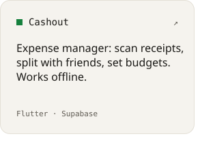
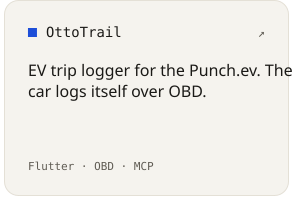
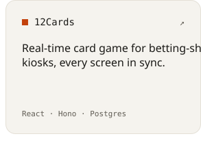

<!-- Every card is an SVG drawn by scripts/render.ts from profile.json and refreshed daily by
     .github/workflows/update-cards.yml. Each card has a light and a -dark version, picked by
     <picture> from your GitHub theme; the colored tiles have one version for both.
     Spacing is baked into the SVGs, so keep this block free of blank lines and keep each row
     of three cards on one line with no spaces. -->

<a href="https://ashternext.com"><picture><source media="(prefers-color-scheme: dark)" srcset="./cards/hero-dark.svg" /></picture></a> 
<picture><source media="(prefers-color-scheme: dark)" srcset="./cards/heatmap-dark.svg" /></picture> 
<picture><source media="(prefers-color-scheme: dark)" srcset="./cards/activity-dark.svg" /></picture> 
 
<picture><source media="(prefers-color-scheme: dark)" srcset="./cards/title-building-dark.svg" /></picture> 
<a href="https://ashternext.com/p/cashout"><picture><source media="(prefers-color-scheme: dark)" srcset="./cards/product-cashout-dark.svg" /></picture></a><a href="https://ashternext.com/p/ottotrail"><picture><source media="(prefers-color-scheme: dark)" srcset="./cards/product-ottotrail-dark.svg" /></picture></a><a href="https://ashternext.com/p/12cards"><picture><source media="(prefers-color-scheme: dark)" srcset="./cards/product-12cards-dark.svg" /></picture></a>

<a href="https://ashternext.com">ashternext.com</a> &nbsp;/&nbsp; <a href="https://medium.com/@maalik">blog</a> &nbsp;/&nbsp; <a href="https://www.linkedin.com/in/maalikb">linkedin</a> &nbsp;/&nbsp; <a href="https://x.com/maalik_b">x</a> &nbsp;/&nbsp; <a href="https://www.upwork.com/freelancers/~01142ad14ffbcfbe3b">upwork</a> &nbsp;/&nbsp; <a href="mailto:malik@ashternext.com">malik@ashternext.com</a>

